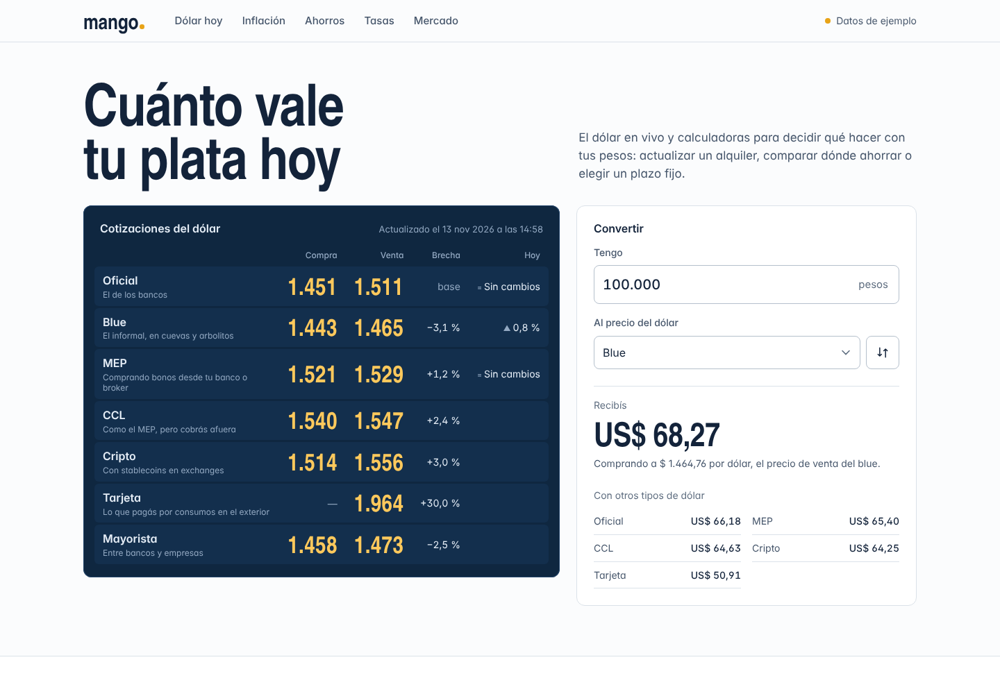
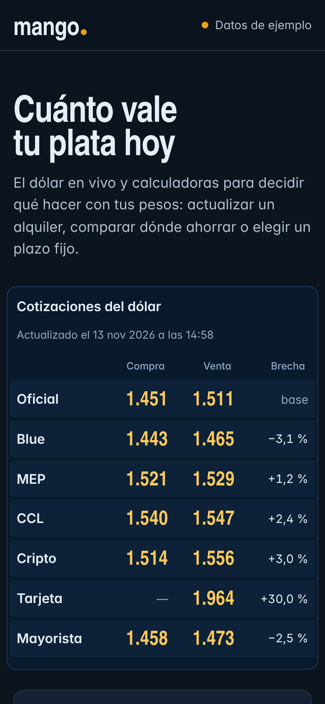

# Mango

El dólar, la inflación y las tasas de Argentina, con calculadoras para decidir qué hacer con tus pesos.

**[Abrir Mango →](https://fran951xd.github.io/Mango/)**



## El problema

En Argentina, cualquiera que cobra un sueldo, paga un alquiler o tiene ahorros necesita responder las mismas preguntas una y otra vez: cuánto está el dólar, cuánto debería subir el alquiler, dónde conviene dejar la plata. La información está repartida en diarios, sitios de bancos y planillas. Mango junta esos datos y, sobre todo, **hace las cuentas**.

## Qué se puede hacer

| Herramienta | Pregunta que responde |
|---|---|
| **Pizarra del dólar** | ¿Cuánto está cada dólar hoy, cuánto cambió y qué brecha tiene con el oficial? |
| **Conversor** | Tengo $ 500.000, ¿cuántos dólares compro? Usa el precio de venta para comprar y el de compra para vender, como en la vida real. |
| **Actualizar por inflación** | Mi alquiler era $ 350.000 en marzo, ¿cuánto debería ser hoy? También funciona hacia atrás. |
| **¿Dónde rindió más tu plata?** | Si hace un año ponía $ 1.000.000 en dólar blue, MEP, oficial o plazo fijo UVA, ¿cuánto tendría hoy? ¿Le gané a la inflación? |
| **Plazo fijo y billeteras** | ¿Qué banco o billetera paga más, cuánto gano en 30, 90 o 365 días y si le gano a la inflación del último mes? |
| **Mercado** | Evolución del dólar, la brecha, la inflación y el riesgo país, con un único filtro de período. |

Cada cálculo se puede **compartir con un enlace**: la dirección guarda el monto y las fechas elegidas.

<p align="center"></p>

## Decisiones técnicas

- **Sin frameworks ni dependencias.** HTML, CSS y JavaScript con módulos ES. Carga rápido, no hay paquetes que mantener y se publica en GitHub Pages sin compilar.
- **Gráficos SVG propios** (`js/charts.js`): crosshair que se engancha a la fecha más cercana, tooltip con el valor primero, etiquetas directas en el último punto, se recorren con el teclado y cada gráfico tiene su versión en tabla.
- **Paleta validada para daltonismo.** Los colores de las series pasaron un validador de separación perceptual (OKLab) en modo claro y oscuro, y cada entidad mantiene su color en todos los gráficos.
- **Datos resilientes.** Caché con vencimiento por fuente (cinco minutos para las cotizaciones, horas para los históricos). Si una API falla se usa la última copia guardada, y si no hay ninguna, datos de ejemplo marcados con un aviso visible. Cada fuente falla por separado sin frenar a las demás.
- **Lógica separada de la interfaz.** Todos los cálculos (inflación compuesta, simulación de inversiones con spread de compra y venta, interés simple, TEA y alineación de series con feriados) son funciones puras en `js/calc.js`, con 30 tests.
- **Accesibilidad.** Navegación completa con teclado, patrones de WAI-ARIA para pestañas y grupos de opciones, textos para lectores de pantalla, contraste AA, modo oscuro propio, respeto por `prefers-reduced-motion` y estilos para impresión.
- **Identidad visual propia.** La pizarra imita los carteles de las casas de cambio. Las tipografías (Inter y TeX Gyre Heros Condensed) se sirven desde el sitio, recortadas al alfabeto latino.

## Estructura

```
├── index.html
├── css/estilos.css          # tokens, componentes, modo oscuro, impresión
├── js/
│   ├── main.js              # carga los datos y los reparte
│   ├── api.js               # fuentes, caché y respaldo
│   ├── calc.js              # cálculos puros (testeados)
│   ├── charts.js            # gráficos SVG y tablas equivalentes
│   ├── format.js            # formatos es-AR y lectura de montos
│   └── ui/                  # una herramienta por archivo
│       ├── pizarra.js  conversor.js  inflacion.js
│       ├── ahorro.js   tasas.js      mercado.js
│       └── dom.js  casas.js
├── fonts/                   # tipografías propias + licencias
├── data/demo.json           # datos de ejemplo (sintéticos)
├── scripts/generar-demo.mjs
├── tests/                   # node --test
└── .github/workflows/ci.yml # tests + publicación en GitHub Pages
```

## Cómo correrlo

Requiere Node 22 o superior para los tests y cualquier servidor estático.

```bash
git clone https://github.com/Fran951xD/mango.git
cd mango
npm run dev    # http://localhost:5173
npm test
```

Con `?demo=1` en la dirección se ven los datos de ejemplo, sin conexión.

## Publicarlo

1. Subí el repositorio a GitHub.
2. En **Settings → Pages**, elegí **GitHub Actions** como origen.
3. Cada push a `main` corre los tests y, si pasan, publica el sitio.

## Fuentes de datos

- [DolarApi](https://dolarapi.com): cotizaciones del día.
- [ArgentinaDatos](https://argentinadatos.com): históricos del dólar, inflación del INDEC, índice UVA, riesgo país y tasas de plazo fijo y billeteras.

Ambas son gratuitas y abiertas. La información es orientativa y no es una recomendación de inversión.

## Próximos pasos

- Alertas: avisar cuando el dólar pase un valor.
- Calculadora de aumento de alquiler con ICL e IPC según el tipo de contrato.
- Funcionar sin conexión como aplicación instalable.

## Autor

**Fran951xD** · [LinkedIn](https://linkedin.com/in/Fran951xD) · [GitHub](https://github.com/Fran951xD)

Código bajo licencia MIT.
